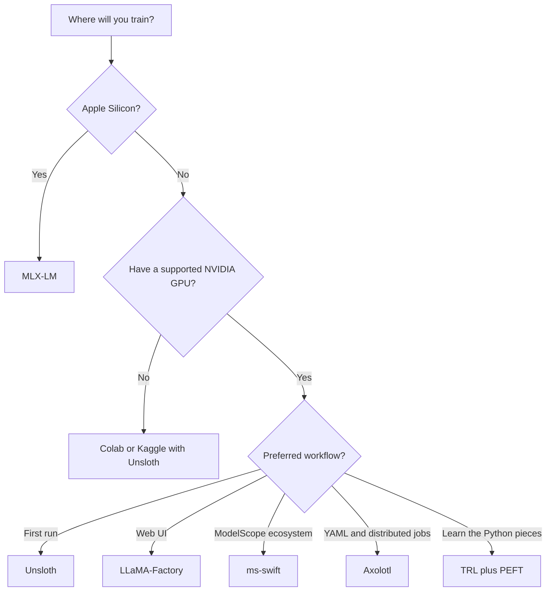

# Choose your tool

These are workflow comparisons, not speed benchmarks. Performance depends on kernels, hardware, sequence length and model.

| Tool | Ease / interface | Speed approach | Memory | Multi-GPU | Mac | Export |
| --- | --- | --- | --- | --- | --- | --- |
| Unsloth | Beginner notebook / Python | Optimized kernels | QLoRA and checkpointing | Check current support | Not this path | Adapter, merged, GGUF |
| MLX-LM | Small CLI | Apple GPU arrays | Quantized base | Advanced distributed setup | Native | MLX, merged; GGUF via conversion |
| LLaMA-Factory | UI or YAML | Backend-dependent | LoRA / QLoRA | Yes | Not covered | Adapter, merged |
| ms-swift | CLI / Python | Backend-dependent | LoRA / QLoRA | Yes | Not covered | Adapter, merged |
| Axolotl | YAML | Kernel/config dependent | QLoRA / checkpointing | Yes | No starter path | Adapter, merged |
| TRL + PEFT | Python | Standard PyTorch stack | Configurable | Accelerate | Device-dependent | Adapter, merged |

Use **Ollama** for a convenient local API, **LM Studio** for a desktop GUI, **llama.cpp** for direct control over GGUF, **MLX-LM** for native Mac inference, **Transformers** for Python experiments, and **vLLM** for GPU serving. Training and serving do not need the same tool.

AMD support is stack-, GPU- and ROCm-version-specific. This repository does not claim a validated AMD training path. Consult current [PyTorch installation guidance](https://pytorch.org/get-started/locally/) and your trainer's supported hardware before renting or buying hardware.

Next: [Train](03-train.md).
